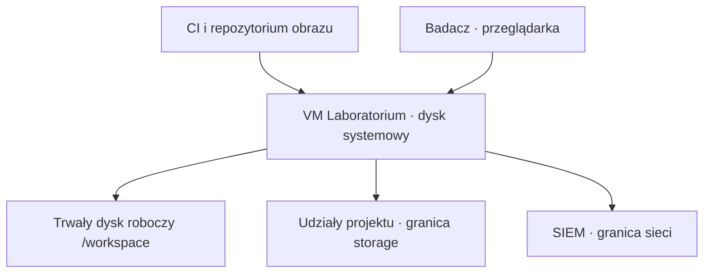
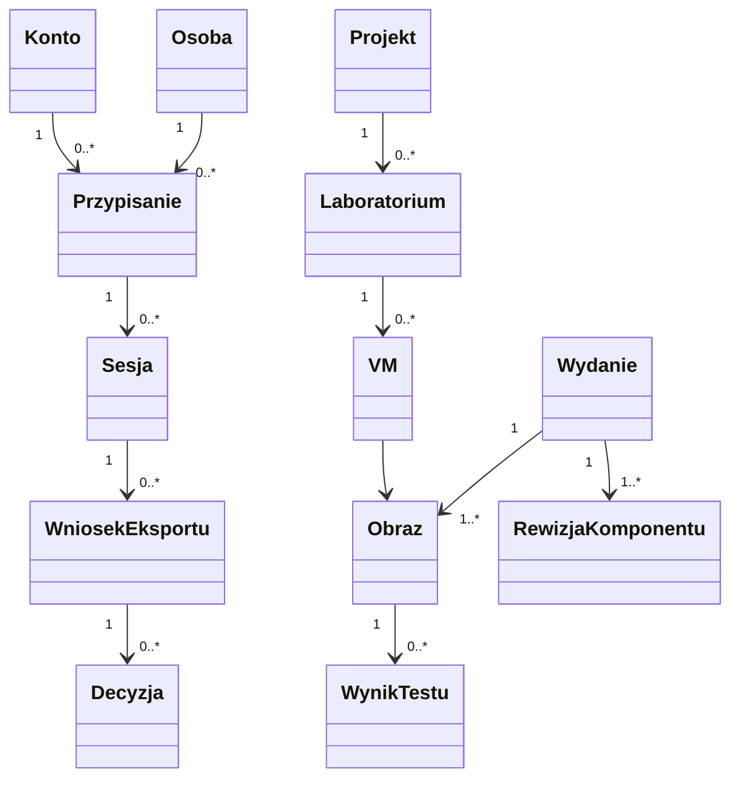
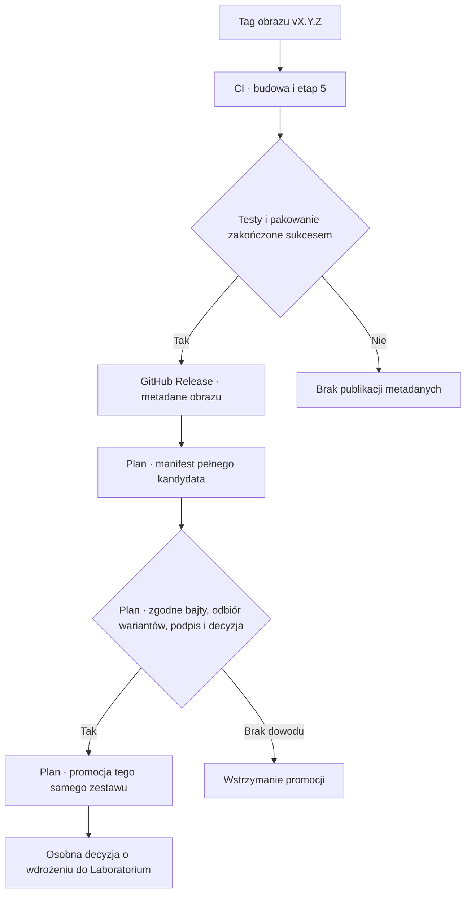
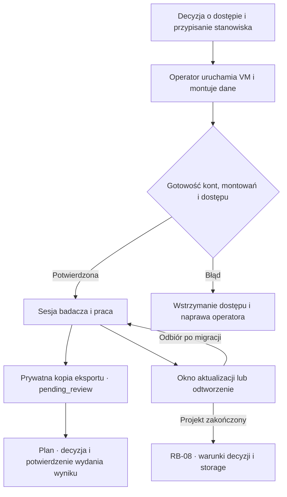
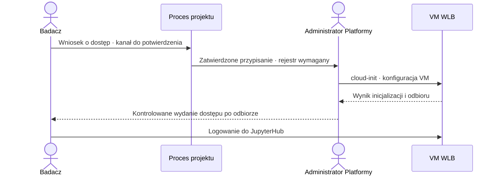
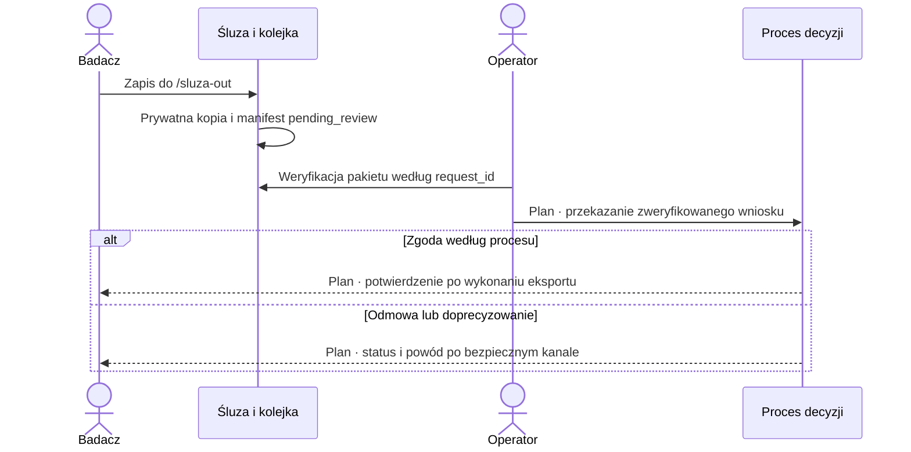
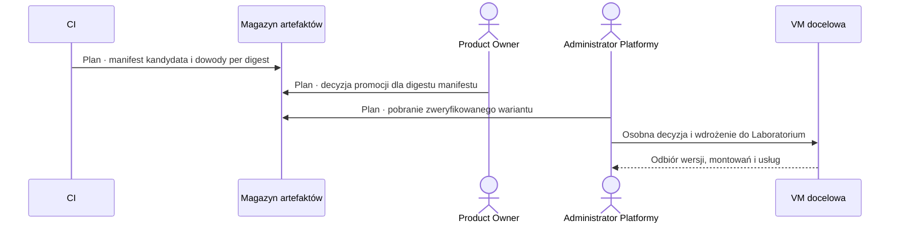
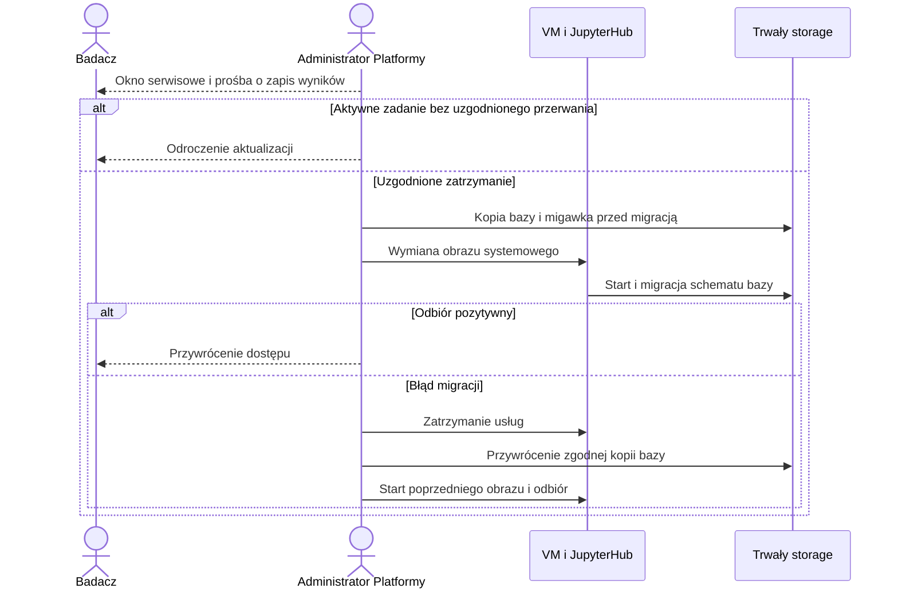

# Architektura i cykl życia WLB

Stan kodu obrazu: `09c8b298e0d385cf31ac4601d9b43e91c548f8ca` (9.11.2026). Zakres: repozytorium obrazu, jego CI i procedury opisane w repozytorium. Inwentarz zewnętrznych usług i repozytoriów wymaga potwierdzenia w [#224](https://github.com/xWuWux/wlb-golden-image/issues/224). Właściciel aktualizacji dokumentu do wyznaczenia. Przy zmianie ról, ścieżek storage lub bramek wydania przeglądamy odpowiedni diagram i wiersz macierzy odbioru.

- **Kod CI/DEV** oznacza mechanizm obecny w bazowej rewizji. Wynik próby należy powiązać z jej przebiegiem.
- **Procedura** oznacza udokumentowane kroki operatora z warunkami wejścia.
- **Plan** oznacza proponowany kontrakt lub etap zależny od decyzji i odbioru. UAT i PROD są w tym dokumencie planem.

[Komponenty i kontrakty](#komponenty-i-kontrakty) · [Przepływy](#przepływy) · [Sekwencje](#sekwencje) · [Macierz odbioru](#macierz-odbioru) · [Decyzje](#decyzje)

## Komponenty i kontrakty

CI buduje obraz przez [Packer](../packer/) i [Ansible](../ansible/site.yml). Operator dostarcza konfigurację konkretnego Laboratorium przez [cloud-init](../cloud-init/lab-user-data.example.yaml). JupyterHub i narzędzia działają na VM, a dane na dysku roboczym i udziałach mają osobny cykl życia. Dostęp przeglądarki zależy od konfiguracji TLS i zapory. Eksport przechodzi przez śluzę, a logi mogą być przekazywane do SIEM. Docelowy backend storage oraz integracje portalu pozostają zależnościami do potwierdzenia. [Konfiguracja startowa](../ansible/roles/lab_config/files/wlb-firstboot) · [Kontrakt obserwowalności](../observability/contract.yml)

### Model pojęciowy

Encje poniżej porządkują identyfikatory używane w odbiorze. Część relacji opisuje przyszły rejestr przypisań i manifest platformy. Implementację struktur kodu wskazuje tabela pod diagramem.

Przypisanie ma historię. Ponowne użycie `u01` tworzy kolejne przypisanie, a wcześniejsze zdarzenia zachowują związek z poprzednią osobą. Manifest eksportu v1 zawiera UID i login. Przejście z tego zapisu do historycznego przypisania wymaga rejestru #102. Sesja w modelu pojęciowym wskazuje kontekst użycia, podczas gdy manifest v1 sam nie rejestruje powiązania z konkretną sesją. [IMG-002](adr/IMG-002-model-kont-badaczy.md) · [Kontrakt kolejki](runbooks/RB-eksport-kolejka.md)

| Kontrakt | Typ i źródło | Odbiorca i warunek awarii | Dowód |
|---|---|---|---|
| `WLB_GIT_COMMIT` | Tekst, pełny SHA z `image_provenance`; commit budowanego checkoutu | Metadane obrazu i `ci/release.sh`; niezgodność z tagiem zatrzymuje pakowanie | [Wersjonowanie](wersjonowanie-wydan.md), [testy wydania](../tests/unit/release.bats) |
| `verify(version, manifest, directory) -> None` | Wersja `str` bez `v`, dwa `Path`; katalog wariantów w repozytorium | CLI zwraca 0 lub 1. Wymaga zgodnych wersji, zestawu, deklaracji bazy i sum plików. Zaufany zapis wejścia warstwy jest osobnym dowodem | [Kod](../ci/verify_platform_images.py), [katalog](../release/image-catalog.json), [testy](../tests/unit/test_verify_platform_images.py) |
| `WLB_EXPORT_QUEUE` | Ścieżka tekstowa w `/etc/wlb/image.conf`, generowana z konfiguracji obrazu | Mover przekazuje prywatny pakiet do kolejki. Operator weryfikuje montowanie, wolne miejsce i stan przerwanego transferu | [Runbook kolejki](runbooks/RB-eksport-kolejka.md), [test movera](../tests/unit/wlb-sluza-out-mover.bats) |
| `create(source: Path, destination: Path, request_id: str) -> Manifest` | Prywatne źródło i nowa ścieżka docelowa. `request_id` to tekst UUID; `state` w v1 przyjmuje `pending_review` | Mover tworzy prywatną kopię. `SnapshotError` lub `OSError` oznacza porażkę CLI. `verify(bundle: Path) -> Manifest` weryfikuje integralność kopii | [Kod](../ansible/roles/storage/files/wlb-export-snapshot), [testy](../tests/unit/test_wlb_export_snapshot.py) |
| `MAX_SESSION_HOURS` | Opcjonalna wartość konfiguracji Laboratorium; domyślna sesja 12 h, opisany limit do 48 h | Operator wyznacza okno aktualizacji i sprawdza aktywne zadania przed odcięciem dostępu | [RB-05](runbooks/RB-05-aktualizacja-i-rollback.md), [RB-sesja-48h](runbooks/RB-sesja-48h.md) |

## Przepływy

### Od commita do wydania i VM

Obecny release z tagu publikuje metadane obrazu. Walidator spójności jest osobnym punktem wejścia. Katalog obejmuje `wlb-general`, `wlb-memory`, `wlb-radiologia` i `wlb-histologia`. Pełny proces platformowy wymaga dowodu źródła bazowego qcow2, wyników wszystkich obowiązkowych prób, podpisu i powiązania decyzji z digestem manifestu. Błąd, brak lub pominięcie obowiązkowej próby powinny wstrzymać promocję. Zmiana bajtów wymaga nowego kandydata. [Workflow](../.github/workflows/release.yml) · [#224](https://github.com/xWuWux/wlb-golden-image/issues/224)

**Próba śledzenia na danych syntetycznych.** Dla planowanego wydania `1.2.0` recenzent odczytuje pełny SHA komponentu i digest bazowego `wlb-general` z manifestu kandydata. Rekord `wlb-memory` wskazuje ten digest jako wejście i ma osobną sumę qcow2. Weryfikator przelicza sumy plików stagingu. Rejestr wdrożeń powinien powiązać ten sam digest wariantu z identyfikatorem `vm-demo-01`, wynikiem odbioru i decyzją. Odczyt `/etc/wlb/image-release` na VM pozwala porównać wersję oraz commit, natomiast powiązanie z konkretnymi bajtami wymaga dowodu od operatora lub hypervisora. Ten ostatni krok jest wymaganiem procesu z #224.

### Od przyznania dostępu do zamknięcia

Gotowość w diagramie to warunek odbioru. Błąd montowania i gotowość sieci po restarcie mają własne scenariusze w [#143](https://github.com/xWuWux/wlb-golden-image/issues/143) i [#251](https://github.com/xWuWux/wlb-golden-image/issues/251). Aktywacja narzędzia na działającej VM jest osobnym procesem proponowanym w [#193](https://github.com/xWuWux/wlb-golden-image/issues/193). Zamknięcie według RB-08 ma warunek potwierdzenia IOD oraz zależność od storage. [RB-08](runbooks/RB-08-zamkniecie-laboratorium.md)

## Sekwencje

| Rola | Odpowiedzialność w tym widoku |
|---|---|
| Administrator danych | Uczestnik procesu nadania dostępu do danych. Punkt decyzji i kanał wymagają potwierdzenia właściciela procesu |
| Administrator Klienta | Ograniczone zarządzanie kontami i serwerami w hubie według IMG-003 |
| Administrator Platformy | Wykonanie konfiguracji VM, odbiór techniczny i odtworzenie |
| Lider Projektu i Kontroler Przesyłu Danych | Odrębne role w procesie eksportu. Kolejność i zakres decyzji do potwierdzenia w #20 |
| Product Owner | Zatwierdzenie promocji konkretnego obrazu według #71. Decyzja dla manifestu platformy jest propozycją #224 |
| Badacz | Wniosek o dostęp, praca w sesji, przekazanie wyniku i odbiór statusu |

### Dostęp i pierwszy start

Administrator danych, Lider Projektu i Administrator Klienta pozostają odrębnymi rolami. To, kto zatwierdza konkretny wniosek i w jakim kanale, musi potwierdzić właściciel procesu. Administrator Platformy wykonuje czynności na VM. Administrator Klienta ma ograniczoną rolę w hubie zgodnie z IMG-003. W modelu kont stanowiskowych operator potrzebuje rejestru historycznego i kontrolowanego przekazania dostępu. [IMG-002](adr/IMG-002-model-kont-badaczy.md) · [IMG-003](adr/IMG-003-zakres-admina-klienta.md) · [#102](https://github.com/xWuWux/wlb-golden-image/issues/102)

### Eksport i decyzja

Dla syntetycznego pliku `wynik-demo.csv` recenzent znajduje manifest według `request_id` i weryfikuje kopię, UID oraz digest. To daje dowód oczekiwania na przegląd. Do powiązania z wynikiem potrzebne są decyzje Lidera i Kontrolera zgodnie z uzgodnionym procesem oraz oddzielny dowód publikacji. Kanał potwierdzenia, odbiór duplikatu i obsługa ponowienia po timeout pozostają częścią projektu #20. Przy przerwanym transferze operator postępuje według runbooka kolejki. [#20](https://github.com/xWuWux/wlb-golden-image/issues/20) · [IMG-008](adr/IMG-008-decyzje-operacyjne-eksportu.md)

### Wydanie i wdrożenie

Magazyn i rejestr decyzji w tym diagramie to role procesu. Kanał, tożsamość podpisującego, zaufanie konsumenta i potwierdzenie aktualizacji pozostają do ustalenia. [#71](https://github.com/xWuWux/wlb-golden-image/issues/71) · [#224](https://github.com/xWuWux/wlb-golden-image/issues/224)

### Aktualizacja, odroczenie i powrót

Wymiana dysku systemowego przerywa procesy działające w pamięci. Pliki zapisane na właściwym dysku roboczym mają przeżyć wymianę. W razie awarii operator rozlicza zmiany bazy i danych od punktu kopii oraz stan kolejki. Przywrócenie całego wolumenu może cofnąć późniejsze wyniki i wymaga osobnej decyzji odtworzeniowej. Poprzedni obraz i zgodna kopia bazy są punktami powrotu. [RB-05](runbooks/RB-05-aktualizacja-i-rollback.md) · [RB-07](runbooks/RB-07-odtworzenie-po-awarii.md)

## Macierz odbioru

| Scenariusz | Dowód obecny w repozytorium | Warunek i luka |
|---|---|---|
| Budowa, błędny digest i brak wariantu | [Testy walidatora](../tests/unit/test_verify_platform_images.py), [workflow wydania](../.github/workflows/release.yml) | Niezgodny zestaw odrzucony. Próbę podpisanej promocji na tych samych bajtach śledzi #224 |
| Start, TLS i dostęp badacza | [Testy firstboot](../tests/unit/wlb-firstboot.bats), [akceptacja VM](../tests/acceptance-remote.sh) | Konto i sesja działają po poprawnej konfiguracji. Brak storage lub błąd audytu wymagają próby odmowy na VM |
| Eksport, zmiana źródła i awaria kolejki | [Testy snapshotu](../tests/unit/test_wlb_export_snapshot.py), [testy movera](../tests/unit/wlb-sluza-out-mover.bats) | Weryfikowalna prywatna kopia. Potrzebny test na docelowym storage oraz dowód decyzji i publikacji |
| Aktualizacja, rollback i zapisane dane | [Harness migracji](../tests/migration.sh), [RB-05](runbooks/RB-05-aktualizacja-i-rollback.md) | Osobna próba z dwoma rzeczywistymi wersjami huba i opcją `--rollback`; sprawdzić UID, logowanie, kolejkę i zgodność schematu |
| Zamknięcie i odtworzenie | [RB-08](runbooks/RB-08-zamkniecie-laboratorium.md), [IMG-006](adr/IMG-006-zamkniecie-laboratorium-usuwanie.md) | Decyzja i potwierdzenie IOD, dowód backendu storage oraz próba respektowania zamknięcia po odtworzeniu |

## Decyzje

| Decyzja i status | Konsekwencja | Alternatywa lub warunek zmiany |
|---|---|---|
| Stanowiska `uNN` i ograniczony `a01` według IMG-002/003 | Stabilne stanowiska wymagają historii przypisań, rozliczenia danych i wycofania dostępu poprzednika | Osobne konto na przypisanie upraszcza historię kosztem liczby kont. IdP wymaga uzgodnienia mapowania i autoryzacji |
| IMG-008, warunkowy fail-stop kolejki w MVP | Przerwany wniosek może zatrzymać kolejne. Wymagane alarm i reakcja operatora | Kwarantanna per wniosek przed wieloma badaczami na VM, osobny wolumen przed produkcją |
| IMG-006, do potwierdzenia przez IOD | Zamknięcie zależy od możliwości storage, polityki kopii i dowodu usunięcia | Wstrzymanie czynności nieodwracalnych do rozstrzygnięcia retencji i wyjątków archiwizacji |
| Promocja zestawu według #224, plan | Jeden manifest wiąże decyzję z kompletem wersji, zwiększa koszt odbioru | Wydania poszczególnych komponentów można utrzymać z macierzą kompatybilności. Promocja całego zestawu wymaga osobnej decyzji |
