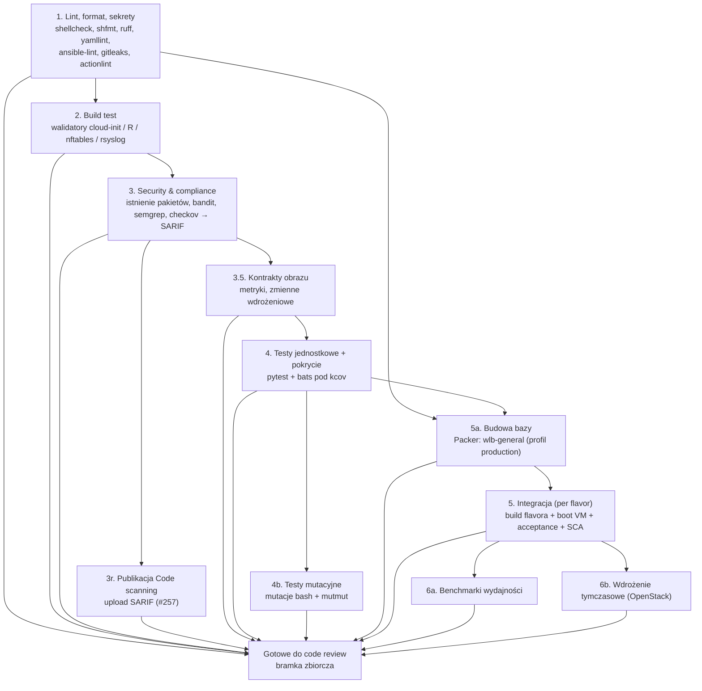
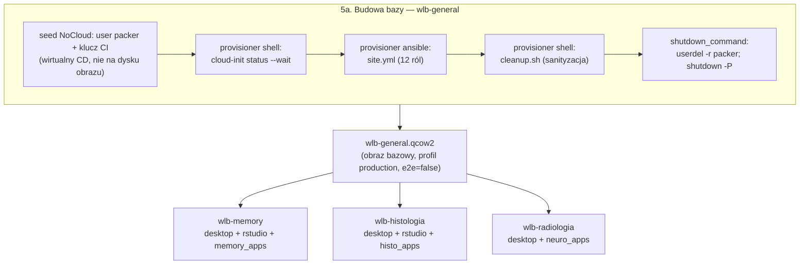

# Cykl wydania obrazu WLB — budowa, walidacja, pierwszy boot

| | |
|---|---|
| **Dokument** | Architektura WLB — Pakiet 3/3 (#226): budowa i wydanie golden image |
| **Odbiorca** | osoba bez wcześniejszego kontaktu z WLB (admin, badacz, recenzent, nowy inżynier) |
| **Zakres** | jak powstaje obraz: potok CI, budowa Packer, kolejność ról Ansible, sanityzacja, warianty (flavory), walidacja na każdym etapie, sekwencja pierwszego bootu |
| **Status** | potok CI, budowa i walidacja **DZIAŁAJĄ w CI**; promocja `stable`/rollback = **PROCES/RUNBOOK** (poza tym repozytorium) |
| **Wersja bazowa** | `main` @ `9a5de7f` (zweryfikowano na tym commicie) |
| **Właściciel aktualizacji** | zespół platformy; przegląd przy zmianie grafu `.github/workflows/ci.yml`, provisionerów Packera, listy ról w `ansible/site.yml`, `cleanup.sh` lub sekwencji `wlb-firstboot` |
| **Powiązania** | #226 (dokumentacja), #317 (macierz flavorów), #257 (SARIF/Code scanning), #251/#268 (bramka dostępu — pierwszy boot), #277 (profil `production` vs `test`), #9 (jedno jądro), #288 (idempotencja) |

> Diagramy w Mermaid renderują się w widoku GitHub. Dokument napisany tak, by prześledzić cały proces bez wcześniejszej znajomości WLB. To element indeksu architektury (patrz [`README.md`](README.md)) — „Cykl wydania obrazu".

## Co to jest „golden image" i po co go budować (dla nowej osoby)

**WLB (Wirtualne Laboratorium Badawcze)** to odizolowana maszyna wirtualna. Każde Laboratorium dostaje VM uruchomioną z jednego, **niezmiennego (immutable) obrazu dysku** — tzw. *golden image*. Zamiast konfigurować każdą VM ręcznie, budujemy **jeden zweryfikowany obraz** i z niego klonujemy wszystkie Laboratoria. Dzięki temu:

- **powtarzalność** — każda VM jest identyczna i opisana commitem,
- **audytowalność** — wiadomo dokładnie, co jest w środku (SBOM, skan CVE, metadane),
- **bezpieczeństwo** — hardening (nftables, AppArmor, audyt, sshd) jest „zapieczony" w obrazie, a nie dokładany po fakcie.

Obraz powstaje **wyłącznie w CI** (GitHub Actions) z kodu w tym repozytorium. Nikt nie buduje go ręcznie na produkcji. Konfiguracja konkretnego Laboratorium (klucz SSH admina, nazwy, CIDR) trafia dopiero **przy wdrożeniu**, przez cloud-init — nie jest częścią obrazu.

## Dwa osobne cloud-inity (częsta pomyłka)

| Cloud-init | Kiedy | Co robi | Klucz SSH |
|---|---|---|---|
| **build-time** (`packer/cloud-init/user-data*.pkrtpl.yaml`) | podczas budowy w CI | tworzy **tymczasowego** użytkownika `packer`, żeby Packer mógł się połączyć i odpalić Ansible | testowy klucz CI — **usuwany** przed zapieczętowaniem obrazu (`userdel -r packer` + `cloud-init clean`) |
| **deploy-time** (`cloud-init/lab-user-data.example.yaml`) | przy wdrożeniu VM | tworzy konto `wlbadmin`, wstrzykuje **prawdziwy** klucz admina, pisze `lab.env` | klucz operatora platformy (spoza repo) |

Obraz jest „czysty": `cloud-init clean --seed` kasuje stan build-time, więc deploy-time cloud-init uruchamia się od nowa na pierwszym boocie docelowej VM.

## Komponenty (co uczestniczy w budowie)

| Element | Gdzie | Rola |
|---|---|---|
| **Orkiestrator CI** | `.github/workflows/ci.yml` | graf etapów 1–6 + bramka „Gotowe do code review" |
| **Skrypty etapów** | `ci/*.sh`, `ci/*.py` | lint, security, kontrakty, testy, integracja, release |
| **Dynamiczny wybór** | `ci/changes.sh` | decyduje, które flavory i etapy 5–6 uruchomić (#317) |
| **Builder obrazu** | `packer/*.pkr.hcl` + QEMU/KVM | buduje qcow2 z chmurowego obrazu Ubuntu |
| **Konfiguracja** | `ansible/site.yml` + role `ansible/roles/*` | instaluje i hartuje system (12 ról) |
| **Sanityzacja** | `packer/scripts/cleanup.sh` | usuwa tożsamość maszyny, sekrety, ślady budowy |
| **Pierwszy boot** | `ansible/roles/lab_config/files/wlb-firstboot` | fail-closed: provisioning + audyt + bramka huba |
| **Artefakty** | qcow2 + `build/ci-logs/*` + SBOM/SARIF | obraz + dowody walidacji |

---

## Diagram 1 — potok CI (kolejność etapów i zależności)

Każdy etap startuje dopiero po swoich zależnościach (`needs:`). Etap 1 dodatkowo decyduje, które flavory i etapy 5–6 w ogóle się uruchomią.



**Istotne zależności:**
- `3.5` i `4` czytają **raporty bezpieczeństwa** z etapu 3, dlatego idą po nim.
- `5a` (budowa bazy) wymaga `lint` **i** `unit` — nie budujemy obrazu, dopóki kod nie przejdzie testów.
- `5` (integracja) buduje flavory **na bazie** z `5a` i uruchamia je jako prawdziwe VM.
- `6a/6b` są pomijane poza ścieżką pełną (zależnie od `changes.sh` i limitów konta).

---

## Diagram 2 — co dzieje się wewnątrz budowy obrazu (Packer)

Budowa to: start VM z seedem build-time → Ansible → sanityzacja → wyłączenie z usunięciem użytkownika `packer`. Baza powstaje pierwsza; flavory dokładają warstwę na gotowej bazie (`disk_image=true`, `base_image=wlb-general.qcow2`).



### Kolejność ról Ansible (`ansible/site.yml`)

Role są **zależne od poprzednich** (np. `tljh` wymaga użytkowników i katalogów z `storage`; `lab_config` hartuje to, co złożyły wcześniejsze role):

| # | Rola | Co wnosi |
|---|---|---|
| 1 | `base` | pakiety bazowe, hardening sshd (klucz-only, `AllowGroups`), użytkownicy platformy |
| 2 | `storage` | katalogi `/workspace`, śluzy, kolejka eksportu, mover, zakresy UID badaczy |
| 3 | `tljh` | JupyterHub (The Littlest JupyterHub) + role admina |
| 4 | `python_env` | środowisko Python badacza |
| 5 | `r_env` | środowisko R |
| 6 | `julia_env` | środowisko Julia |
| 7 | `rstudio` | serwer RStudio |
| 8 | `desktop` | pulpit XFCE + noVNC (dla flavorów z GUI) |
| 9 | `audit` | reguły auditd + jednostka `wlb-audit-rules` (ładowana przy pierwszym boocie, potem `-e 2`) |
| 10 | `logging` | przekazywanie logów do SIEM (rsyslog + TLS) |
| 11 | `monitoring` | node-exporter / metryki (#22) |
| 12 | `lab_config` | **`wlb-firstboot`** (sekwencja pierwszego bootu), nftables, limity sesji |

> Flavory (wlb-memory/histologia/radiologia) uruchamiają osobne playbooki (`ansible/{desktop,histologia,radiologia}.yml`) **na gotowej bazie** — dokładają tylko warstwę aplikacji i aktualizują metadane obrazu.

### Sanityzacja (`cleanup.sh`) — co usuwa przed zapieczętowaniem

- **Stare jądra/moduły/nagłówki** → zostaje dokładnie jedno jądro (fail-stop przy dwóch, #9).
- **Sekrety huba** (`jupyterhub_cookie_secret`, baza SQLite) → generowane od nowa na pierwszym boocie.
- **Klucze hosta SSH** (`/etc/ssh/ssh_host_*`) → odtwarza cloud-init.
- **`cloud-init clean --logs --machine-id --seed`** → kasuje tożsamość maszyny i cache seedu build-time (w tym testowy klucz CI).
- **Ślady** — `/tmp`, `/var/tmp`, historia, cache, logi; `fstrim` zwalnia bloki.

---

## Walidacja — co dowodzi każdy etap

| Etap | Narzędzie / plik | Czego dowodzi | Typ |
|---|---|---|---|
| 1. Lint | shellcheck, shfmt `-i 2`, ruff, yamllint, ansible-lint, gitleaks, actionlint | styl, składnia, brak sekretów | statyczny |
| 2. Build test | walidatory systemowe (`ci/*validate*`) | poprawność cloud-init / nftables / R / rsyslog przed budową | statyczny |
| 3. Security | `ci/security.sh` → `check_package_existence.py`, bandit, semgrep, checkov | pakiety istnieją w repo Ubuntu; brak znanych anty-wzorców | statyczny + sieć |
| 3r. Code scanning | upload SARIF | widoczność w zakładce Security GitHub (#257) | raport |
| 3.5. Kontrakty | `ci/observability.sh` (`metrics_check`, `deployment_vars`) | metryki i zmienne wdrożeniowe spójne (`lab.env` ↔ firstboot ↔ przykłady) | statyczny |
| 4. Unit | pytest + bats pod **kcov** | jednostki (parsery, firstboot, eksport, …) + **pokrycie** | dynamiczny |
| 4b. Mutacje | `ci/mutation.sh`, mutmut | testy faktycznie **zabijają** wprowadzone błędy (nie są puste) | dynamiczny |
| 5a. Baza | `packer build` wlb-general | obraz bazowy **realnie się buduje** (profil production, e2e=false) | budowa |
| 5. Integracja | `ci/integration.sh` → boot VM + `tests/acceptance.sh` + osv-scanner | **realna VM** przechodzi akceptację; SBOM + skan CVE obrazu | E2E |
| 6a. Perf | benchmarki | budżety wydajności nie są przekroczone | E2E |
| 6b. Ephemeral | deploy OpenStack | obraz startuje na prawdziwej chmurze | E2E |
| Gotowe | bramka zbiorcza | **wszystkie** wymagane etapy zielone | bramka |

**Zasada fail-closed walidacji:** pominięty/anulowany etap nie liczy się jako „czysto"; bramka „Gotowe do code review" wymaga jawnego sukcesu każdego wymaganego joba.

---

## Diagram 3 — pierwszy boot VM (sekwencja fail-closed)

To **nie** jest część budowy — dzieje się przy **pierwszym starcie** wdrożonej VM. `wlb-firstboot` (z roli `lab_config`) startuje z **zamkniętą** bramką huba i otwiera ją **dopiero** po potwierdzeniu gotowości (#251/#268). Awaria na dowolnym etapie zostawia hub zamknięty; kanał SSH operatora zostaje do naprawy.

```mermaid
sequenceDiagram
  autonumber
  participant CI as cloud-init (deploy)
  participant FB as wlb-firstboot
  participant NFT as nftables
  participant AU as auditd
  participant HUB as JupyterHub

  CI->>FB: start przy pierwszym boocie (lab.env gotowe)
  FB->>NFT: write_nftables 0 (bramka huba ZAMKNIĘTA, SSH otwarty)
  FB->>FB: walidacja lab.env, TLS, CIDR
  FB->>HUB: pre-provisioning kont uNN / a01 (zapis do SQLite, nie przez port)
  FB->>HUB: hub_ready? (lokalne API, bramka zamknięta)
  FB->>AU: systemctl start wlb-audit-rules (augenrules --load; auditctl -e 2)
  FB->>AU: verify_audit_ready (auditctl -s = enabled 2 + reguły) [#268]
  alt audyt potwierdzony w jądrze
    FB->>NFT: write_nftables 1 (bramka huba OTWARTA dla HUB_ALLOWED_CIDR)
    FB->>FB: zapis firstboot.done (atomowo)
  else audyt niepotwierdzony / błąd fazy
    FB->>NFT: trap fail_closed_on_exit → bramka pozostaje ZAMKNIĘTA
    Note over FB,HUB: hub niedostępny z sieci; operator wchodzi po SSH i naprawia
  end
```

**Dlaczego tak:** otwarcie dostępu do huba następuje **po** udowodnieniu w jądrze, że audyt działa i jest zablokowany (`-e 2`) — sam kod wyjścia `systemctl` nie wystarcza, bo usługa z `ConditionPathExists` może zwrócić 0 bez wykonania (#268, kryterium 2).

---

## Wersjonowanie i artefakty

- **Metadane obraz** (`/etc/wlb/image-release`): `WLB_IMAGE_NAME`, `WLB_IMAGE_VERSION`, `WLB_IMAGE_DATE`, commit — zapisywane przez `post_tasks` w `site.yml`.
- **Artefakty CI**: `image-<run_id>` (qcow2), `build/ci-logs/*` (logi, kontrakty, SARIF), `image-sca` (SBOM + skan CVE), `coverage`, `mutation`.
- **Promocja `stable` / rollback**: **poza** tym repozytorium — osobny proces/runbook wydania (zaznaczone jako luka w indeksie architektury).

## Mapa źródeł (plik → symbol)

| Temat | Plik |
|---|---|
| Graf etapów CI | `.github/workflows/ci.yml` |
| Dynamiczny wybór flavorów/etapów | `ci/changes.sh` |
| Budowa bazy + flavorów | `ci/integration.sh` (`build_image`), `packer/*.pkr.hcl` |
| Kolejność ról | `ansible/site.yml` |
| Sanityzacja | `packer/scripts/cleanup.sh` |
| Profil production/test (#277) | `packer/variables.pkr.hcl` (`wlb_build_profile`) |
| Pierwszy boot | `ansible/roles/lab_config/files/wlb-firstboot` |
| Weryfikacja audytu (#268) | `wlb-firstboot` → `verify_audit_ready` |

---

> **Status elementów** (konwencja indeksu): potok CI, budowa, sanityzacja i sekwencja pierwszego bootu **DZIAŁAJĄ w CI/DEV** (dowód: `ci.yml`, `cleanup.sh`, testy `wlb-firstboot.bats`). Promocja `stable`/rollback — **PROCES** poza repo. Per-boot re-weryfikacja gotowości (jednostka systemd) i wydzielenie bramki huba — **w toku** (#268, kryteria 1/3).
