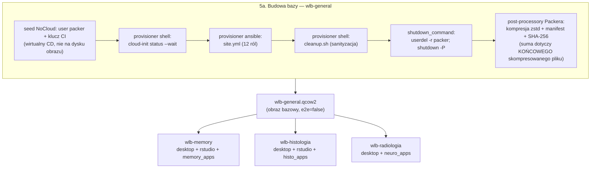
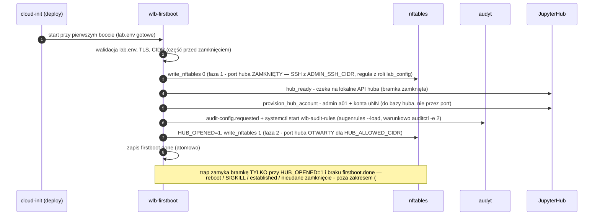
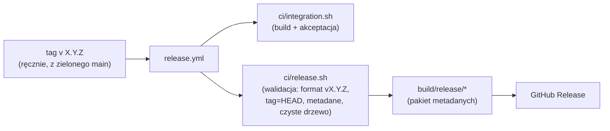

# Cykl wydania obrazu WLB — budowa, walidacja, pierwszy boot

| | |
|---|---|
| **Dokument** | Architektura WLB — pakiety 2–3 (#226): budowa, walidacja i wydanie golden image |
| **Odbiorca** | osoba bez wcześniejszego kontaktu z WLB (admin, badacz, recenzent, nowy inżynier) |
| **Zakres** | jak powstaje obraz: potok CI, budowa Packer, kolejność ról Ansible, sanityzacja, warianty (flavory), walidacja na każdym etapie, sekwencja pierwszego bootu |
| **Status** | potok CI, budowa i walidacja **DZIAŁAJĄ w CI**; wydanie (tag `v*` → `release.yml` → `ci/release.sh` → GitHub Release metadanych) jest **w repo, częściowo** — magazyn qcow2, podpis/weryfikacja importu i wywołanie `verify_platform_images.py` w release to **luka #71/#224** |
| **Wersja bazowa / przegląd** | opisuje stan `main`; zweryfikowano ponownie **2026-11-20** względem bieżącego `main` (firstboot, `release.yml`; potwierdzono brak `verify_audit_ready` i `wlb_build_profile` w main) po recenzji #366 |
| **Właściciel aktualizacji** | zespół platformy; przegląd przy zmianie grafu `.github/workflows/ci.yml`, provisionerów Packera, listy ról w `ansible/site.yml`, `cleanup.sh` lub sekwencji `wlb-firstboot` |
| **Powiązania** | #226 (dokumentacja), #317 (macierz flavorów), #257 (SARIF/Code scanning), #251/#268 (bramka dostępu — pierwszy boot), #277 (profil `production` vs `test`), #9 (jedno jądro), #288 (idempotencja) |

> Diagramy w Mermaid renderują się w widoku GitHub. Dokument napisany tak, by prześledzić cały proces bez wcześniejszej znajomości WLB. To element indeksu architektury (patrz [`README.md`](README.md)) — „Cykl wydania obrazu".

## Co to jest „golden image" i po co go budować (dla nowej osoby)

**WLB (Wirtualne Laboratorium Badawcze)** to odizolowana maszyna wirtualna. Każde Laboratorium dostaje VM uruchomioną z jednego **obrazu dysku wydania** (*golden image*), identyfikowanego przez **digest konkretnego qcow2**. Obraz budujemy raz; VM dostaje **osobną konfigurację i stan** przy wdrożeniu (niezmienny artefakt wydania ≠ niezmienna działająca VM ani identyczne bajty przy ponownym buildzie tego samego commita). Dopuszczenie do wydania jest osobną polityką. Dzięki temu:

- **powtarzalność** — artefakt wydania jest opisany commitem i identyfikowany digestem qcow2,
- **audytowalność** — inwentarz obrazu jest raportowany (SBOM, skan CVE, metadane); skany wykrywają wzorce wg konfiguracji, nie dowodzą nieobecności podatności,
- **bezpieczeństwo** — hardening (nftables, AppArmor, audyt, sshd) jest „zapieczony" w obrazie, a nie dokładany po fakcie.

Obraz jest budowany przez **CI** (GitHub Actions) z kodu w tym repozytorium; `Makefile` udostępnia też lokalne `make build` dla dewelopera. Dopuszczenie do wydania jest osobną polityką. Konfiguracja konkretnego Laboratorium (klucz SSH admina, nazwy, CIDR) trafia dopiero **przy wdrożeniu**, przez cloud-init — nie jest częścią obrazu.

## Dwa osobne cloud-inity (częsta pomyłka)

| Cloud-init | Kiedy | Co robi | Klucz SSH |
|---|---|---|---|
| **build-time** (`packer/cloud-init/user-data*.pkrtpl.yaml`) | podczas budowy w CI | tworzy **tymczasowego** użytkownika `packer`, żeby Packer mógł się połączyć i odpalić Ansible | testowy klucz CI — **usuwany** przed zapieczętowaniem obrazu (`userdel -r packer` + `cloud-init clean`) |
| **deploy-time** (`cloud-init/lab-user-data.example.yaml`) | przy wdrożeniu VM | tworzy konto `wlbadmin`, wstrzykuje **prawdziwy** klucz admina, pisze `lab.env` | klucz operatora platformy (spoza repo) |

Obraz jest „czysty": `cloud-init clean --seed` kasuje stan build-time, więc deploy-time cloud-init uruchamia się od nowa na pierwszym boocie docelowej VM.

## Komponenty (co uczestniczy w budowie)

| Element | Gdzie | Rola |
|---|---|---|
| **Orkiestrator CI** | `.github/workflows/ci.yml` | graf etapów 1–6 + bramka „Gotowe do code review" |
| **Skrypty etapów** | `ci/*.sh`, `ci/*.py` | lint, security, kontrakty, testy, integracja, release |
| **Dynamiczny wybór** | `ci/changes.sh` | decyduje, które flavory i etapy 5–6 uruchomić (#317) |
| **Builder obrazu** | `packer/*.pkr.hcl` + QEMU/KVM | buduje qcow2 z chmurowego obrazu Ubuntu |
| **Konfiguracja** | `ansible/site.yml` + role `ansible/roles/*` | instaluje i hartuje system (12 ról) |
| **Sanityzacja** | `packer/scripts/cleanup.sh` | usuwa tożsamość maszyny, sekrety, ślady budowy |
| **Pierwszy boot** | `ansible/roles/lab_config/files/wlb-firstboot` | fail-closed: provisioning + audyt + bramka huba |
| **Artefakty** | qcow2 + `build/ci-logs/*` + SBOM/SARIF | obraz + dowody walidacji |

---

## Diagram 1 — potok CI (kolejność etapów i zależności)

Każdy etap startuje dopiero po swoich zależnościach (`needs:`). Etap 1 dodatkowo decyduje, które flavory i etapy 5–6 w ogóle się uruchomią.

**Istotne zależności:**
- `3.5` i `4` czytają **raporty bezpieczeństwa** z etapu 3, dlatego idą po nim.
- `5a` (budowa bazy) wymaga `lint` **i** `unit` — nie budujemy obrazu, dopóki kod nie przejdzie testów.
- `5` (integracja) buduje flavory **na bazie** z `5a` i uruchamia je jako prawdziwe VM.
- `6a/6b` są pomijane poza ścieżką pełną (zależnie od `changes.sh` i limitów konta).

### Tabela zależności i warunków etapów

Odwzorowanie `.github/workflows/ci.yml` (stan main). **Bramkuje** = job jest w `needs:` bramki „Gotowe do code review" (`ready`), więc jego porażka blokuje merge. Joby warunkowe z fałszywym `if` są **pomijane** (`skipped`) — `ci/ready.sh` traktuje pominięcie warunkowego etapu jako OK, nie jako porażkę.

| Etap (job) | `needs:` | Kiedy biegnie (`if`) | Bramkuje? | Główny artefakt |
|---|---|---|---|---|
| 1. Lint (`lint`) | — | zawsze | tak | wyjścia `image` / `flavors` (sterują etapami 5–6) |
| 2. Build test (`build-check`) | `lint` | zawsze | tak | — |
| 3. Security (`security`) | `build-check` | zawsze | tak | SARIF (semgrep, checkov) |
| 3r. Code scanning (`security-report`) | `security` | `!cancelled()` i `security` ∈ {success, failure} | tak | publikacja SARIF do GitHub Code Scanning |
| 3.5. Kontrakty obrazu (`observability`) | `security` | zawsze | tak | — (kontrakt obserwowalności + Wazuh) |
| 4. Testy jednostkowe (`unit`) | `observability` | zawsze | tak | `coverage`, `test-reports`, `flaky.json` |
| 4b. Mutacje (`mutation`) | `unit` | zawsze | tak | `mutation` |
| 5a. Budowa bazy (`build-base`) | `lint`, `unit` | `needs.lint.outputs.image == 'true'` | tak (gdy biegnie) | `image-<run_id>` (bazowy qcow2) |
| 5. Integracja (`integration`) | `lint`, `unit`, `build-base` | `image == 'true'`; macierz `flavor = fromJSON(flavors)` | tak (gdy biegnie) | `acceptance.xml`, `image-sca` |
| 6a. Benchmarki (`perf`) | `lint`, `integration` | etykieta `perf` / dispatch / nightly | tak (gdy biegnie) | wyniki benchmarków |
| 6b. Wdrożenie tymczasowe (`ephemeral`) | `lint`, `integration` | etykieta `deploy-test` / dispatch | tak (gdy biegnie) | — (OpenStack) |
| Gotowe do code review (`ready`) | wszystkie powyższe | zawsze (`!cancelled()`) | — (to **jest** bramka) | karta oceny (`ci/ready.sh`) |

**Raportowe (nie-bramkujące) elementy w bramkujących jobach:** część KROKÓW biegnie `continue-on-error` i nie czerwieni joba — m.in. skan SCA zbudowanego obrazu (`image-sca`, etap 5), Lynis oraz lustro akceptacji. To świadome „raport, nie bramka" (#138): wynik jest widoczny w podsumowaniu, ale nie blokuje. Granicę bramkujące ↔ raportowe trzyma `ci/ready.sh` i flagi `WLB_*_GATING`.

---

## Diagram 2 — co dzieje się wewnątrz budowy obrazu (Packer)

Budowa to: start VM z seedem build-time → Ansible → sanityzacja → wyłączenie z usunięciem użytkownika `packer`. Baza powstaje pierwsza; flavory dokładają warstwę na gotowej bazie (`disk_image=true`, `base_image=wlb-general.qcow2`).

### Kolejność ról Ansible (`ansible/site.yml`)

Lista to **kolejność wykonania**, nie dowód, że każda rola zależy od bezpośrednio poprzedniej (choć niektóre zależą — np. `tljh` wymaga użytkowników/katalogów z `storage`; `lab_config` hartuje to, co złożyły wcześniejsze). **12 pozycji, w tym 2 warunkowe** — `rstudio` i `desktop` instalują się tylko dla flavorów, które ich wymagają:

| # | Rola | Co wnosi |
|---|---|---|
| 1 | `base` | pakiety bazowe, hardening sshd (klucz-only, `AllowGroups`), użytkownicy platformy |
| 2 | `storage` | katalogi `/workspace`, śluzy, kolejka eksportu, mover, zakresy UID badaczy |
| 3 | `tljh` | JupyterHub (The Littlest JupyterHub) + role admina |
| 4 | `python_env` | środowisko Python badacza |
| 5 | `r_env` | środowisko R |
| 6 | `julia_env` | środowisko Julia |
| 7 | `rstudio` | serwer RStudio |
| 8 | `desktop` | pulpit XFCE + noVNC (dla flavorów z GUI) |
| 9 | `audit` | reguły auditd + jednostka `wlb-audit-rules` (ładowana przy pierwszym boocie, potem `-e 2`) |
| 10 | `logging` | przekazywanie logów do SIEM (rsyslog + TLS) |
| 11 | `monitoring` | node-exporter / metryki (#22) |
| 12 | `lab_config` | **`wlb-firstboot`** (sekwencja pierwszego bootu), nftables, limity sesji |

> Flavory (wlb-memory/histologia/radiologia) uruchamiają osobne playbooki (`ansible/{desktop,histologia,radiologia}.yml`) **na gotowej bazie** — dokładają tylko warstwę aplikacji i aktualizują metadane obrazu.

### Sanityzacja (`cleanup.sh`) — co usuwa przed zapieczętowaniem

- **Stare jądra/moduły/nagłówki** → zostaje dokładnie jedno jądro (fail-stop przy dwóch, #9).
- **Sekrety huba** (`jupyterhub_cookie_secret`, baza SQLite) → generowane od nowa na pierwszym boocie.
- **Klucze hosta SSH** (`/etc/ssh/ssh_host_*`) → odtwarza cloud-init.
- **`cloud-init clean --logs --machine-id --seed`** → kasuje tożsamość maszyny i cache seedu build-time (w tym testowy klucz CI).
- **Ślady** — `/tmp`, `/var/tmp`, historia, cache, logi; `fstrim` zwalnia bloki.

---

## Walidacja — co dowodzi każdy etap

| Etap | Narzędzie / plik | Czego dowodzi | Typ |
|---|---|---|---|
| 1. Lint | shellcheck, shfmt `-i 2`, ruff, yamllint, ansible-lint, gitleaks, actionlint | styl, składnia, brak sekretów | statyczny |
| 2. Build test | walidatory systemowe (`ci/*validate*`) | poprawność cloud-init / nftables / R / rsyslog przed budową | statyczny |
| 3. Security | `ci/security.sh` → `check_package_existence.py`, bandit, semgrep, checkov | pakiety istnieją w repo Ubuntu; brak znanych anty-wzorców | statyczny + sieć |
| 3r. Code scanning | upload SARIF | widoczność w zakładce Security GitHub (#257) | raport |
| 3.5. Kontrakty | `ci/observability.sh` (`metrics_check`, `deployment_vars`) | metryki i zmienne wdrożeniowe spójne (`lab.env` ↔ firstboot ↔ przykłady) | statyczny |
| 4. Unit | pytest + bats pod **kcov** | jednostki (parsery, firstboot, eksport, …) + **pokrycie** | dynamiczny |
| 4b. Mutacje | `ci/mutation.sh`, mutmut | testy faktycznie **zabijają** wprowadzone błędy (nie są puste) | dynamiczny |
| 5a. Baza | `packer build` wlb-general | obraz bazowy **realnie się buduje** (e2e=false via `wlb_enable_e2e_target`) | budowa |
| 5. Integracja | `ci/integration.sh` → boot VM + `tests/acceptance.sh` + osv-scanner | **realna VM** przechodzi akceptację; SBOM + skan CVE obrazu | E2E |
| 6a. Perf | benchmarki | budżety wydajności nie są przekroczone | E2E |
| 6b. Ephemeral | deploy OpenStack | obraz startuje na prawdziwej chmurze | E2E |
| Gotowe | bramka zbiorcza | **wszystkie** wymagane etapy zielone | bramka |

**Zasada fail-closed walidacji:** pominięty/anulowany etap nie liczy się jako „czysto"; bramka „Gotowe do code review" wymaga jawnego sukcesu każdego wymaganego joba.

---

## Diagram 3 — pierwszy boot VM (sekwencja, stan main)

To **nie** jest część budowy — dzieje się przy **pierwszym starcie** wdrożonej VM. `wlb-firstboot` (z roli `lab_config`) zamyka **port huba** regułą nftables (faza 1), wykonuje konfigurację i otwiera port **po** starcie jednostki audytu (faza 2). **Kontrakt ograniczony:** `trap fail_closed_on_exit` próbuje zamknąć bramkę **tylko** gdy `HUB_OPENED=1` i brak `firstboot.done`; reboot, SIGKILL, istniejące połączenia (`established,related` poprzedza regułę huba), nieudane zamknięcie oraz ponowienie z istniejącym markerem **nie są** tą sekwencją objęte — to osobny odbiór **#268**.

**Uwaga do #268 (NIEzrealizowane w main):** kryterium 2 #268 proponuje `verify_audit_ready` — odczyt `auditctl -s` (enabled=2) i porównanie reguł **przed** otwarciem portu, bo sam kod wyjścia `systemctl start wlb-audit-rules` może być 0, gdy `ConditionPathExists` pominie usługę. **W main tej funkcji nie ma** (jest w otwartym PR #365). Diagram powyżej pokazuje stan main: po `systemctl start` następuje `write_nftables 1` bez dodatkowego odczytu stanu jądra.

---

## Wersjonowanie i artefakty

- **Metadane obraz** (`/etc/wlb/image-release`): `WLB_IMAGE_NAME`, `WLB_IMAGE_VERSION`, `WLB_IMAGE_DATE`, commit — zapisywane przez `post_tasks` w `site.yml`.
- **Artefakty CI**: `image-<run_id>` (qcow2), `build/ci-logs/*` (logi, kontrakty, SARIF), `image-sca` (SBOM + skan CVE), `coverage`, `mutation`.

### Wydanie (tag → pakiet metadanych) — co JEST w repo

Osobny workflow `.github/workflows/release.yml` na tag `v*`: buduje i testuje przez `ci/integration.sh`, wywołuje `ci/release.sh`, publikuje `build/release/*` jako GitHub Release.

**Jawne luki (nie 'poza repo', lecz niedomknięte):**
- `ci/release.sh` publikuje **pakiet metadanych, nie sam qcow2** — magazyn obrazu, podpis i weryfikacja przy imporcie: stan **#71/#224**.
- Istnieje walidator `ci/verify_platform_images.py` + katalog `release/image-catalog.json`, ale **release.yml/release.sh go nie wywołują** — jawna luka, nie brak narzędzia.
- „Tag z zielonego main" to **instrukcja w komentarzu** workflow, nie techniczna kontrola `needs` wobec CI.
- Promocja tego samego digestu bez przebudowy i próba odtworzenia: **#224/#71**.
- Rollback: runbook `docs/runbooks/RB-05-aktualizacja-i-rollback.md`.

## Mapa źródeł (plik → symbol)

| Temat | Plik |
|---|---|
| Graf etapów CI | `.github/workflows/ci.yml` |
| Dynamiczny wybór flavorów/etapów | `ci/changes.sh` |
| Budowa bazy + flavorów | `ci/integration.sh` (`build_image`), `packer/*.pkr.hcl` |
| Kolejność ról | `ansible/site.yml` |
| Sanityzacja | `packer/scripts/cleanup.sh` |
| Przełącznik targetu E2E (w main) | `packer` var `wlb_enable_e2e_target` (bool, domyślnie `false`) → ansible extra-vars → warunkowa instalacja targetu E2E |
| Pierwszy boot | `ansible/roles/lab_config/files/wlb-firstboot` |
| Wydanie / rollback | `.github/workflows/release.yml`, `ci/release.sh`, `docs/runbooks/RB-05-aktualizacja-i-rollback.md`, `ci/verify_platform_images.py`, `release/image-catalog.json` |
| **Propozycje (NIE w main)** | #268: `verify_audit_ready` (PR #365) · #277-S3: profil `wlb_build_profile` (PR #360) |

---

> **Status elementów — co jest dowiedzione testem, a co tylko opisane / zaplanowane** (konwencja indeksu):
>
> | Element | Stan | Dowód / uwaga |
> |---|---|---|
> | Potok CI (kolejność, `needs`, warunki) | działa (dowiedziony) | `ci.yml` + tabela zależności wyżej; `ci/ready.sh` z testami `test_ready.py` |
> | Budowa obrazu (Packer → Ansible → sanityzacja) | działa (dowiedziony) | `packer/`, `ansible/site.yml`, `cleanup.sh`; dowód wykonania: etap 5, gdy biegnie |
> | Sekwencja pierwszego bootu (dwufazowa bramka nftables) | działa (dowiedziony) | testy jednostkowe `wlb-firstboot.bats`; akceptacja na realnej VM w etapie 5 |
> | Wydanie: tag → `release.yml` → `release.sh` → GitHub Release metadanych | **częściowo** | mechanizm jest w repo, ale **opisany/niepełny**: magazyn qcow2, podpis i weryfikacja importu, wywołanie `verify_platform_images.py` w release oraz promocja tego samego digestu — **luki #71/#224** |
> | Per-boot re-weryfikacja gotowości (`verify_audit_ready`, bramka huba przed `established`) | **tylko opisane** | **propozycja #268** (kryteria 1–3), **niezaimplementowana w main**; PR #365 realizuje kryterium 2 |
>
> **Dowód wykonania ≠ dowód poprawności:** „działa (dowiedziony)" znaczy, że mechanizm jest wdrożony **i pokryty testem** — nie że każdy flavor/etap wykonał się w danym przebiegu. Skan sekretów/CVE wykrywa wzorce wg konfiguracji; brak znalezisk **nie dowodzi** braku podatności. Skan obrazu w CI jest `continue-on-error` i tylko dla `wlb-general`, nie każdego flavora. Diagramy Mermaid zweryfikowane renderem (`mermaid-cli`).
