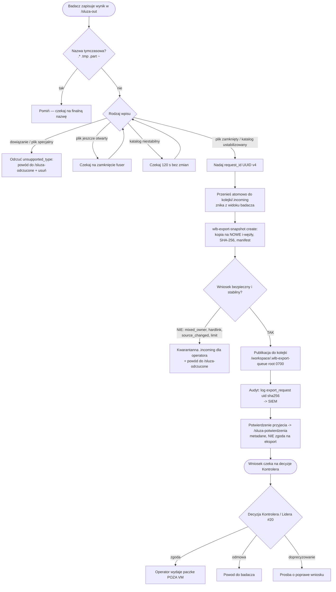
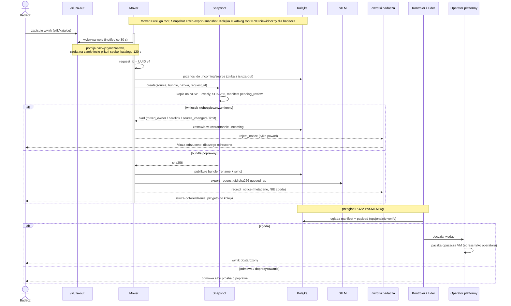

# Śluza wyjściowa (eksport danych) — architektura i przepływ

| | |
|---|---|
| **Dokument** | Architektura WLB — Pakiet 2/3 (#226): śluza wyjściowa |
| **Odbiorca** | osoba bez wcześniejszego kontaktu z WLB (admin, badacz, recenzent) |
| **Zakres** | eksport danych przez `wlb-sluza-out`: mover, migawka, kolejka, decyzja, audyt |
| **Status** | automatyka **DZIAŁA w CI/DEV** (mover + snapshot + audyt + feedback); zatwierdzenie i wydanie poza VM = **DECYZJA/PROCES** (#20) |
| **Wersja bazowa** | `main` @ `ef1ee0f` (zweryfikowano na tym commicie) |
| **Właściciel aktualizacji** | zespół platformy; przegląd przy zmianie `wlb-sluza-out-mover`/`wlb-export-snapshot`, kontraktu kolejki albo decyzji #20 |
| **Powiązania** | #226 (dokumentacja), #20 (autoryzacja eksportu), IMG-008/#162 (PR #176), #149 (limity usługi), #208 (potwierdzenia), §24/§14.7 Regulaminu |

> Diagramy w Mermaid renderują się w widoku GitHub (zwalidowane `mermaid-cli`). Napisane tak, by prześledzić cały proces bez wcześniejszej znajomości WLB. To pierwszy sformalizowany element indeksu architektury (patrz `docs/architektura/README.md`).

## Co to jest WLB i po co śluza (dla nowej osoby)

**WLB (Wirtualne Laboratorium Badawcze)** to odizolowana maszyna wirtualna (VM) na Laboratorium. Badacz pracuje w **przeglądarce** (JupyterHub), a VM jest **air-gapped**: ruch wychodzący z sieci jest domyślnie zablokowany, dane **nie opuszczają VM** w sposób niekontrolowany (wymóg RODO / Regulaminu §24).

Powstaje problem: badacz musi **wysłać wynik na zewnątrz** (np. wykres, tabelę). Nie może tego zrobić sam (brak egressu). Służy do tego **śluza wyjściowa** — jedyna, kontrolowana i audytowana droga danych na zewnątrz, z **decyzją człowieka** (Kontroler Przesyłu Danych / Lider). Analogia: śluza powietrzna — wrzucasz przesyłkę do przedziału, który badacz traci z oczu; po kontroli zostaje wypuszczona albo odrzucona.

## Komponenty (co fizycznie istnieje na VM)

| Element | Ścieżka / nazwa | Prawa | Rola |
|---|---|---|---|
| **Skrzynka nadawcza** | `/sluza-out` | zapis badacza | badacz **wrzuca** tu plik/katalog do eksportu |
| **Usługa (mover)** | `wlb-sluza-out.service` → `/usr/local/sbin/wlb-sluza-out-mover` | root, cgroups (#149) | automat: wykrywa wpis, pakuje, kolejkuje, loguje |
| **Helper migawki** | `wlb-export-snapshot` | root | tworzy/weryfikuje **paczkę** (kopia + SHA-256 + manifest) |
| **Kolejka przeglądu** | `/workspace/.wlb-export-queue` | **root 0700** (niewidoczna dla badacza) | wnioski czekające na decyzję |
| **Zwrotka: odrzucenia** | `/sluza-odrzucone` | badacz (0750) | **powód** odrzucenia (bez treści danych) |
| **Zwrotka: potwierdzenia** | `/sluza-potwierdzenia` | badacz (0750) | potwierdzenie **przyjęcia do kolejki** (nie zgoda!) (#208) |
| **Audyt** | syslog → SIEM | — | każdy wniosek: `uid`, `sha256`, czas |

## Mechanizmy (dlaczego to jest bezpieczne)

- **Kopia na NOWE i-węzły, nie przeniesienie** — po skopiowaniu badacz (nawet z otwartym deskryptorem) **nie zmieni** już recenzowanej kopii (odporność na TOCTOU, #33).
- **Atomowość + „rename po sukcesie"** — paczka pojawia się w kolejce dopiero gdy jest kompletna; błąd nigdy nie publikuje części.
- **SHA-256 + manifest** (JSON v1, stan `pending_review`, nadawca, spis plików) — integralność; manifest to lokalne metadane root, **nie** podpis ani zgoda.
- **Kwarantanna** (`.incoming`) przy błędzie — nic nie jest kasowane ani ponawiane automatycznie; bada operator.
- **Fail-safe** — błąd zwrotki/potwierdzenia nigdy nie zatrzymuje movera (cicho `return 0`).
- **Limity bezpieczeństwa** — maks. 100 GiB, 100 000 plików, głębokość 64; odrzucane: dowiązania sym/tw., FIFO, pliki specjalne, **różni właściciele** w jednym wniosku.
- **Odporność na wyścigi** — pomija nazwy tymczasowe (`.* .tmp .part ~`), czeka na zamknięcie pliku (`fuser`) i na **ustabilizowanie katalogu** (120 s bez zmian).
- **Rozdział widoczności** — badacz widzi tylko skrzynkę i zwrotki; kolejki przeglądu (root 0700) nie widzi.
- **Separacja: przyjęcie ≠ zgoda** — potwierdzenie mówi „jest w kolejce"; o eksporcie decyduje **człowiek** (#20).

## Przepływ — flowchart

## Przepływ — diagram sekwencji

## Etapy krok po kroku

1. **Nadanie** — badacz zapisuje plik/katalog w `/sluza-out`.
2. **Wykrycie** — mover budzi się (inotify `close_write`/`moved_to`/`create`, najpóźniej co 30 s). Pomija nazwy tymczasowe; czeka na zamknięcie pliku (`fuser`) i na ustabilizowanie katalogu (120 s).
3. **Przejęcie** — nadanie `request_id` (UUID v4) i **atomowe przeniesienie** do `.incoming` w kolejce; wpis **znika z `/sluza-out`**.
4. **Migawka** — `wlb-export-snapshot create`: kopia payloadu na **nowe i-węzły**, SHA-256 per plik + digest spisu, `manifest.json` (`pending_review`). Odrzuca niebezpieczne/zmieniające się drzewa.
5. **Rozgałęzienie**:
   - **błąd** → kwarantanna `.incoming` (dla operatora) + `reject_notice` (powód do `/sluza-odrzucone`);
   - **sukces** → publikacja paczki do kolejki (`rename` + `sync`).
6. **Audyt** — log `export_request user uid entry sha256 queued_as` do syslog → SIEM.
7. **Potwierdzenie** — `receipt_notice` do `/sluza-potwierdzenia` (nazwa, czas, UUID, liczba plików, rozmiar, sha256 — **tylko metadane, nie zgoda**).
8. **Decyzja (człowiek, #20)** — Kontroler/Lider ogląda manifest + payload (może `verify`) i: **zgoda** → operator wydaje paczkę poza VM; **odmowa**/**doprecyzowanie** → informacja do badacza.

## Co działa, a co jest decyzją (oznaczenie #226)

| Etap | Stan | Dowód |
|---|---|---|
| Mover: wykrycie, przejęcie, kolejkowanie, odrzucenia, kwarantanna | **DZIAŁA (CI/DEV)** | `ansible/roles/storage/files/wlb-sluza-out-mover`; `tests/unit/wlb-sluza-out-mover.bats` |
| Migawka: kopia na nowe i-węzły, SHA-256, manifest, verify | **DZIAŁA (CI/DEV)** | `ansible/roles/storage/files/wlb-export-snapshot`; `tests/unit/test_wlb_export_snapshot.py` |
| Usługa + limity zasobów (cgroups) | **DZIAŁA (CI/DEV)** | `wlb-sluza-out.service`, `60-resources.conf.j2` (#149); `tests/sluza_resources.py`, `tests/unit/test_sluza_resources.py` |
| Audyt do SIEM | **DZIAŁA (CI/DEV)** | `log export_request …` → kontrakt obserwowalności |
| Potwierdzenia przyjęcia | **DZIAŁA (CI/DEV)** | `receipt_notice` (#208) |
| **Zatwierdzenie i wydanie poza VM** | **DECYZJA / PROCES** | **#20** (autoryzacja eksportu), IMG-008 (#162/PR #176); kanał wydania = operator, brak automatu w obrazie |

## Słownik ról (fragment #226)

- **Badacz** — wnioskuje (wrzuca), otrzymuje potwierdzenie/odrzucenie.
- **Mover (`wlb-sluza-out`)** — wykonuje (automat root): stażuje, loguje, powiadamia.
- **Kontroler Przesyłu Danych / Lider Projektu** — decyduje o eksporcie (#20).
- **Administrator Platformy / Operator** — obsługuje kwarantannę, wydaje zatwierdzoną paczkę poza VM.

---
*Etap 1/… dla #226 (śluza wyjściowa). Kolejne etapy: import (`/sluza-in`), cykl wydania obrazu, tworzenie Laboratorium, model domenowy (classDiagram). Dane syntetyczne. Zweryfikowane na bieżącym `main`.*
